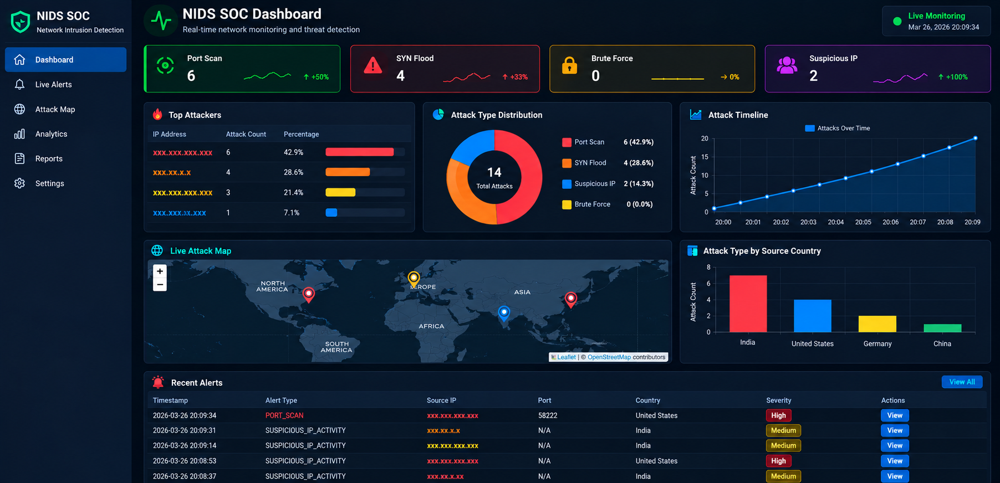

# Network Intrusion Detection System (NIDS) + SOC Dashboard

A Python/Flask dashboard for visualizing alert records produced by the Scapy-based NIDS monitor.

## Features

- Dark SOC-style responsive dashboard
- Port scan, SYN flood, SSH brute-force and unique suspicious-IP counters
- Top source IPs and attack-type distribution
- Timeline grouped by minute
- Recent alert table with severity labels
- Approximate public-IP geolocation map
- Auto-refreshing dashboard data and `/health` endpoint

## Requirements

- Python 3.9+
- Install packages with `python -m pip install -r requirements.txt`
- Internet connection for the map tiles and chart libraries (CDN)
- Administrator/root privileges may be required to sniff packets

## Run the dashboard

Open PowerShell or a terminal in this folder:

```powershell
python -m venv .venv
.\.venv\Scripts\Activate.ps1
python -m pip install -r requirements.txt
python dashboard.py
```

On Windows, if PowerShell blocks activation, use `.\.venv\Scripts\python.exe dashboard.py` after installing packages into that environment, or open Command Prompt and run `.venv\Scripts\activate.bat`.

Then open http://127.0.0.1:5000.

The dashboard reads `alerts.log` beside `dashboard.py` by default. To use another log file, set `NIDS_LOG_FILE` before launching the dashboard.

## Run the packet monitor

Run this only on a network you own or have explicit permission to monitor. Packet capture may require administrator/root privileges.

```powershell
python nids.py
```

Set the adapter and log path through environment variables if needed:

```powershell
$env:NIDS_INTERFACE="Wi-Fi"
$env:NIDS_LOG_FILE="$PWD\alerts.log"
python nids.py
```

On Linux, for example:

```bash
sudo env NIDS_INTERFACE=eth0 NIDS_LOG_FILE="$PWD/alerts.log" python3 nids.py
```

If `NIDS_INTERFACE` is unset, Scapy chooses its default interface. Check available adapter names with Scapy or your operating system's network tools.

## 📸 Project Screenshots


## Notes and limitations

- This is a learning/demo project, not a production IDS.
- The dashboard displays records from `alerts.log`; the counters are based on logged events, not independently verified attacks.
- IP geolocation is approximate, may fail for private IP addresses, and uses an external lookup service. The map does not prove an attacker's physical location.
- The timeline is grouped by minute from the log timestamps.
- Detection thresholds are configured in `nids.py`. Validate and tune them for your environment.
- IP blocking is disabled by default (`ENABLE_BLOCKING = False`). Do not enable automatic blocking without understanding the impact and testing in an authorized lab.
